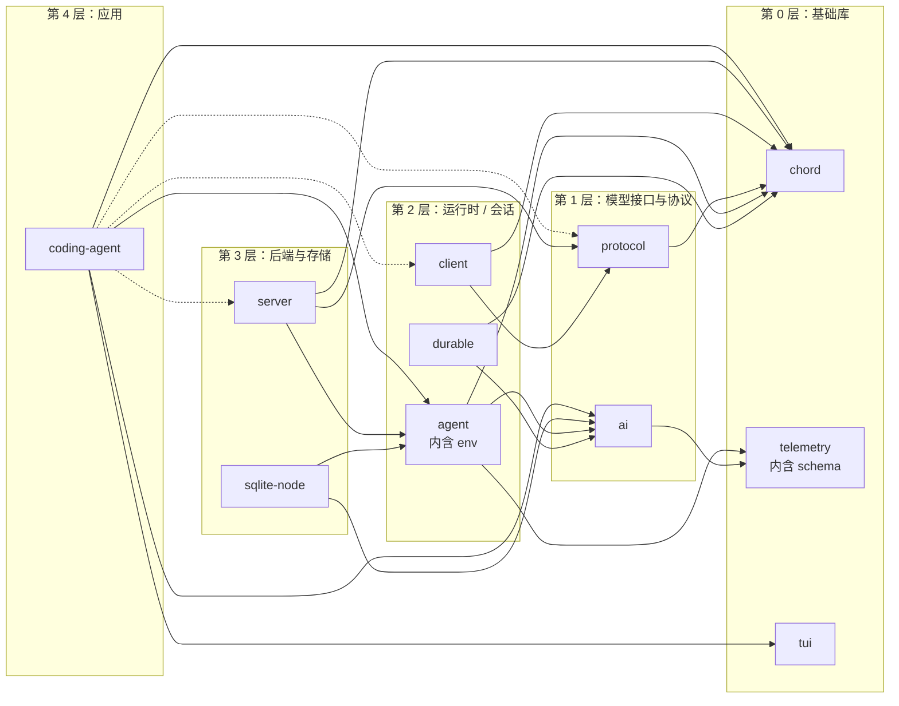

# 实践课 2：组织建仓与源码分析

- 姓名：瞿凯峰　学号：202430194023　姓名拼音：QuKaifeng
- 小组：`hunnuOpenSourceSoftware2026Group001`
- 小组代码仓库：https://github.com/hunnuOpenSourceSoftware2026Group001/pi-hunnu-2026
- 分析对象：本机 `D:\师大本科WORK\github\pi-hunnu-2026`，分支 `course-main`，commit `13cbf77df2396303013a41646bcfa77b4271ae56`
- 报告日期：2026-11-26

## 一、源码获取

### 1. 小组组织内的仓库

课程要求 fork 到小组 Organization，而不是组长个人账号。打开小组仓库页面后，页面左上方显示 Owner 为 `hunnuOpenSourceSoftware2026Group001`，仓库名 `pi-hunnu-2026`，Public，详情见 `screenshots/S0-org-repo-page.png`。这里说明一点：网页默认分支显示为 `main`，且内容比本机 clone 新（页面上有 v1.5.2 的提交）；本机按要求下载的是课程用的 `course-main` 分支，所以两边提交号不一样，不能拿网页截图代替本地 clone 的证据。

fork 动作由组长在组织内完成，本次我负责从该组织仓库下载源码并分析。实际 clone 地址为：

```text
https://github.com/hunnuOpenSourceSoftware2026Group001/pi-hunnu-2026.git
```

### 2. 本机 clone 与版本核验

源码目录为全英文路径 `D:\师大本科WORK\github\pi-hunnu-2026`。在仓库根目录执行了：

```powershell
Get-Location
git remote -v
git branch --show-current
git rev-parse HEAD
git status --short
```

真实输出（见 `screenshots/S1-git-info.png`，该图与`实践课3`的 S2 同源，为同一次真实终端操作）：

| 项目 | 实际结果 |
|---|---|
| 当前目录 | `D:\师大本科WORK\github\pi-hunnu-2026` |
| origin (fetch/push) | `https://github.com/hunnuOpenSourceSoftware2026Group001/pi-hunnu-2026.git` |
| 当前分支 | `course-main` |
| HEAD | `13cbf77df2396303013a41646bcfa77b4271ae56` |
| 工作区 | 当时无改动 |

源码目录截图见 `screenshots/S1-source-directory.png`，可见 `.github`、`packages`、`scripts`、`package.json`、`README.md` 等。注意本机后来为了实践 3、4 安装了依赖并修改了两处源码，因此现在的 `git status` 与当时截图不同，这是后续实验造成的，不影响当时 clone 的证据。

## 二、模块分析

完整逐条依据（文件路径 + 行号）见同目录 `模块分析-源码依据.md`。下面给出用于验收的表格、依赖图与问题回答，结论均来自本地源码，不拿包名简介当分析。

### 1. 作业表格与本版本包的对应

本版本 `packages/` 一级目录实际是：`agent`、`ai`、`chord`、`client`、`coding-agent`、`durable`、`evals`、`protocol`、`server`、`session-backends`、`telemetry`、`tui`；`session-backends/sqlite-node` 是真正的子包。

| 作业表格名字 | 本版本情况 |
|---|---|
| `telemetry` | 存在 |
| `schema` | 无独立包；类型化 schema 工具内嵌在 telemetry |
| `chord` | 存在 |
| `tui` | 存在 |
| `codemode` | 未找到目录、包或 import，不能硬凑 |
| `mcp` | 无独立包，且 `coding-agent/README.md:501` 明确写 “No MCP.” |
| `ai` | 存在 |
| `durable` | 存在 |
| `env` | 无独立包；`NodeExecutionEnv` 内嵌在 agent 的 harness |
| `agent` | 存在，包名 `@earendil-works/pi-agent-core` |
| `coding-agent` | 存在 |

作业表格少列了实际参与构建的 `protocol`、`client`、`server`、`session-backends/sqlite-node`；`evals` 只有评估脚本，没有 build。

### 2. 模块分析表

> “直接依赖”只写能从 `package.json` 或源码 import 证实的内部包；开发依赖单独标出。

| 子文件夹 | 主要实现 | build 执行与产物 | 直接内部依赖 | 依据 |
|---|---|---|---|---|
| `telemetry` | span/属性/状态契约、类型化 schema 定义与推导、内存实现 | `tsgo -p tsconfig.build.json` → `dist/index.js`、`.d.ts`、`.map` | 无 | `packages/telemetry/package.json:22-27`；`src/index.ts:1-74,345-357` |
| `schema` | 内嵌于 telemetry 的 `defineTelemetrySchema` 等类型工具 | 随 telemetry 编译 | 随 telemetry | `packages/telemetry/src/index.ts:26-74,122-144` |
| `chord` | facet、service、replicated state、RPC/wire 协议，提供 `./bundler`、`./node` 子入口 | `tsgo -p tsconfig.build.json` → `dist/` | 无 | `packages/chord/package.json:42-47,65-71`；`src/index.ts:1-12` |
| `tui` | 终端 UI 库，差量渲染、布局、编辑器、补全、按键绑定等 | `tsgo -p tsconfig.build.json` → `dist/index.js`；原生加速脚本不在默认 build 链路 | 无 | `packages/tui/package.json:9-15,50-61`；`src/index.ts:5-156` |
| `codemode` | 本版本未找到证据 | — | — | Glob/Grep 无结果 |
| `mcp` | 本版本不内置；由扩展自行实现 | — | — | `packages/coding-agent/README.md:501`；`docs/usage.md:310` |
| `ai` | 统一多 provider LLM API、模型发现、provider 配置 | `generate-models`（联网刷新模型目录）→ `check:model-data` → `tsgo` → 拷贝 `src/providers/data` 到 `dist/providers/data` | `pi-telemetry` | `packages/ai/package.json:54-65,69`；`scripts/generate-models.ts` |
| `durable` | 持久化 conversation/task/document 运行时 | `tsgo -p tsconfig.build.json` → `dist/`；tsconfig `paths` 指向 chord/ai 的 dist 声明 | `chord`、`pi-ai` | `packages/durable/package.json:22-27,44-51`；`src/memory-storage.ts:1` |
| `env` | 内嵌于 agent 的执行环境，`NodeExecutionEnv` | 随 agent 编译 | 随 agent | `packages/agent/package.json:25-28`；`src/harness/env/nodejs.ts:438` |
| `agent` | 通用 agent runtime：agent loop、transport、状态、附件、压缩、工具调度 | `tsgo -p tsconfig.build.json` → `dist/` | `chord`、`pi-ai`、`pi-telemetry` | `packages/agent/package.json:47-51,61-69`；`src/agent.ts:1-13`、`agent-loop.ts:17` |
| `coding-agent` | CLI 应用：read/bash/edit/write 工具、会话、扩展、TUI、RPC | `tsgo` + `chmod` + `copy-assets` + esbuild bundle → `dist/bundle/cli.js` 等 | `chord`、`pi-agent-core`、`pi-ai`、`pi-tui`；开发依赖 `client`/`protocol`/`server` | `packages/coding-agent/package.json:40-50,52-55,76-78`；`scripts/build-coding-agent-bundle.mjs` |
| `protocol`（补） | 远端会话 CBOR 协议与分帧 | `tsgo` → `dist/` | `chord` | `packages/protocol/package.json:18-23,42` |
| `client`（补） | 分帧 CBOR 的远端会话客户端 | `tsgo` → `dist/` | `chord`、`pi-protocol` | `packages/client/package.json:25-31,50-51` |
| `session-backends/sqlite-node`（补） | Node sqlite 会话后端 | `tsgo` + `copy-migrations.mjs` → `dist/` | `pi-ai`、`pi-agent-core` | 对应 `package.json:19-25,38-39` |
| `server`（补） | 实验性 pi server | `tsgo` → `dist/` | `chord`、`pi-agent-core`、`pi-protocol` | `packages/server/package.json:27-34,50-52` |
| `evals`（补） | 私有评估包，无 build 脚本 | 不进根 build | 开发依赖 `ai`、`coding-agent` | `packages/evals/package.json:1-23` |

### 3. 依赖关系图

箭头方向统一为“使用方 → 被依赖方”。实线是运行时直接依赖，虚线是开发依赖/实验目录依赖。图源：`dependencies.mmd`（可直接用 Mermaid 编辑器打开修改）。



分层依据：第 0 层没有内部依赖；第 1 层只依赖第 0 层；第 2 层依赖第 0/1 层；第 3 层依赖 agent/protocol；`coding-agent` 的四个运行时依赖都在下层，所以最后构建。`codemode` 没有找到任何证据，没有画成节点；`mcp` 明确不内置。完整版图（含 evals 虚线与注释）见 `dependencies.mmd`。

### 4. 三个问题的回答

**Q1 根目录与子模块中的 `npm run build` 分别读取什么配置、执行什么工作？**
根 build 读根 `package.json:16` 的 `scripts.build`，内容只是一串 `cd packages/xxx && npm run build`；它自己不读 tsconfig，也不编译。子包 build 读各自 `package.json` 的 `scripts.build`，通常是 `tsgo -p tsconfig.build.json`；该 tsconfig 继承根 `tsconfig.base.json`，把 `src` 编译到本包 `dist`，并用 `paths` 把内部包名指到邻居已生成的 `dist/*.d.ts`。ai 会先联网生成模型目录，coding-agent 会额外 esbuild 打包与拷贝资源，sqlite-node 会拷贝 migration。

**Q2 构建顺序和模块依赖有什么关系？相邻构建的模块是否一定互相依赖？**
顺序大体按拓扑排：被依赖方先构建，例如 agent/durable/coding-agent 的 tsconfig 都把依赖指到邻居的 dist 声明。但相邻不等于互相依赖：`chord → tui` 互不依赖；`tui → telemetry` 互不依赖；sqlite-node 与 protocol 也不是上下游。根脚本只是把依赖线性化，不是一条首尾相接的依赖链。

**Q3 选一条涉及至少三个模块的依赖路径，说明分工。**
选 `coding-agent → agent → ai → telemetry`。`coding-agent` 处理 CLI 参数、会话、工具和 TUI，把用户输入组织成 prompt；`agent` 在 `agent-loop.ts` 中组装上下文、调度工具、跑循环，不关心具体厂商；`ai` 统一各家 provider 的流式接口与模型目录，并把调用上报为 span；`telemetry` 只定义 span/属性/schema 契约，不依赖内部包。越往下越通用。

## 三、截图索引

| 文件 | 内容 |
|---|---|
| `screenshots/S0-org-repo-page.png` | 真实浏览器打开小组组织仓库，Owner 为 `hunnuOpenSourceSoftware2026Group001` |
| `screenshots/S1-git-info.png` | 本地目录、origin、分支、HEAD 提交号 |
| `screenshots/S1-source-directory.png` | 资源管理器中的源码目录，含 packages、package.json、README.md |

## 四、提交说明

个人报告放在个人作业仓库；Issue 标题：`实践课2：组织建仓与源码分析 QuKaifeng`，正文附本报告链接与小组仓库链接。 Issue 本身需由本人账号发起，当前未提交。
