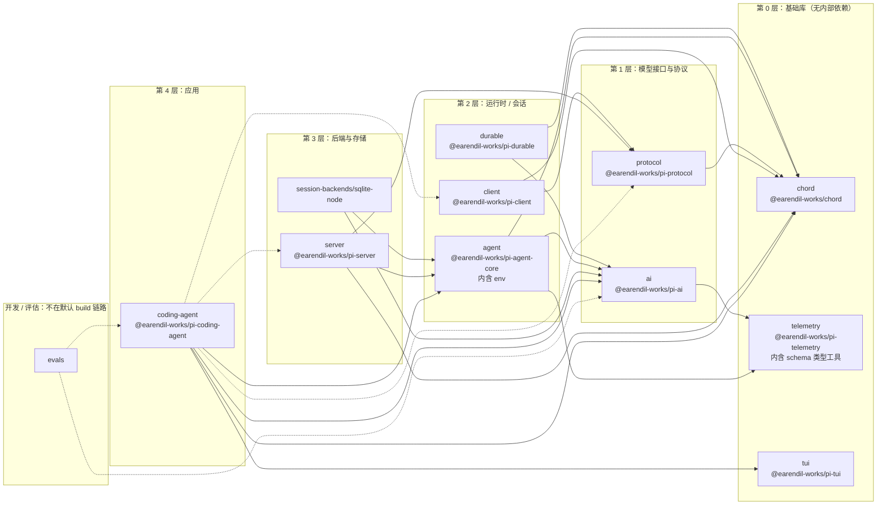

# 模块分析——源码依据（实践 02 / 任务三）

分析对象：`pi-hunnu-2026`，commit `13cbf77df2396303013a41646bcfa77b4271ae56`，分支 `course-main`，origin 为 `https://github.com/hunnuOpenSourceSoftware2026Group001/pi-hunnu-2026.git`（用 `git rev-parse HEAD` / `git branch --show-current` / `git remote -v` 核对）。本次只读取源码，没有改动仓库里的任何文件。下面所有结论都来自本地文件；凡是找不到证据的地方，直接写“未在本版本找到证据”。

---

## 一、`packages/` 实际目录清单，以及和作业表格的对照

仓库根目录 `packages/` 下实际只有这 12 个一级条目（`ls packages/`）：

`agent`、`ai`、`chord`、`client`、`coding-agent`、`durable`、`evals`、`protocol`、`server`、`session-backends`、`telemetry`、`tui`

其中 `session-backends/` 下面还有一个真正的包 `sqlite-node`（`packages/session-backends/sqlite-node/package.json`）。根 `package.json:5-13` 的 workspaces 还额外列了 5 个 `coding-agent/examples/extensions/*` 示例包（`with-deps`、`custom-provider-anthropic`、`custom-provider-gitlab-duo`、`sandbox`、`gondolin`），它们不是独立的构建模块。`packages/coding-agent/install-lock/package.json` 存在，但不在 workspaces 列表里。

按 `packages/*/package.json` 中的 `name` 字段汇总，实际包名为：

`@earendil-works/chord`、`@earendil-works/pi-telemetry`、`@earendil-works/pi-ai`、`@earendil-works/pi-durable`、`@earendil-works/pi-agent-core`、`@earendil-works/pi-coding-agent`、`@earendil-works/pi-tui`、`@earendil-works/pi-protocol`、`@earendil-works/pi-client`、`@earendil-works/pi-server`、`@earendil-works/pi-session-backend-sqlite-node`、`@earendil-works/pi-evals`

作业表格里那 11 个文件夹在本版本的对应情况：

| 作业表格里的名字 | 本版本情况 | 依据 |
|---|---|---|
| `telemetry` | 存在 | `packages/telemetry/package.json:2` |
| `schema` | **没有独立包**；类型化 schema 工具内嵌在 telemetry 中 | `packages/telemetry/src/index.ts:26-74` 定义 `TelemetryAttributeDefinition`、`TelemetrySchemaDefinition`、`defineTelemetrySchema`；全仓库没有 `schema/` 目录或同名包（Glob `**/schema*/**` 无结果） |
| `chord` | 存在 | `packages/chord/package.json:2` |
| `tui` | 存在 | `packages/tui/package.json:2` |
| `codemode` | **未在本版本找到证据**：没有目录、没有包、没有相关 import。搜索命中的 `opencode.models.ts`、`commandcodeModel` 是别的词，不是模块 | Glob `**/{codemode}/**` 无结果；`Grep "codemode|codeMode|code-mode"` 只命中测试变量名 |
| `mcp` | **没有独立包，而且明确说明不内置** | `packages/coding-agent/README.md:501` 原文 “**No MCP.** … build an extension that adds MCP support”；`README.md:397` 把 “MCP server integration” 列为扩展能做到的事；`docs/usage.md:310` 同样说不包含 built-in MCP |
| `ai` | 存在 | `packages/ai/package.json:2` |
| `durable` | 存在 | `packages/durable/package.json:2` |
| `env` | **没有独立包**；作为 agent 的 harness 子模块内嵌 | `packages/agent/package.json:25-28` 导出 `./harness/env/nodejs`；实现在 `packages/agent/src/harness/env/nodejs.ts:438` 的 `NodeExecutionEnv`；被 `packages/coding-agent/src/experimental/mini/server/run.ts:14` import |
| `agent` | 存在（包名 `@earendil-works/pi-agent-core`） | `packages/agent/package.json:2` |
| `coding-agent` | 存在 | `packages/coding-agent/package.json:2` |

所以作业表格少列了本版本实际参与构建的 4 个包：`protocol`、`client`、`server`、`session-backends/sqlite-node`；另有 `evals` 只在 workspaces 中，没有 build 脚本。下面表格把这些也补进去，避免按旧表格硬凑不存在的包。

---

## 二、模块分析表

> “直接依赖”只写能从 `package.json` 的 `dependencies` / `devDependencies` / `peerDependencies` 或源码 `import` 证实的内部包；“开发依赖”单独标注。外部 npm 包不算内部模块。

| 子文件夹 | 代码主要实现什么功能 | 本模块 build 执行什么、生成什么 | 直接依赖哪些内部模块 | 依据文件或代码位置 |
|---|---|---|---|---|
| `telemetry` | 厂商中立的遥测契约：span/属性/状态接口（`src/index.ts:1-22`），类型化 schema 定义与推导（`src/index.ts:26-74`、`122-144`），`createTypedSpanStarter`（`src/index.ts:345-354`），内存实现 `InMemoryTelemetryContext`（`src/index.ts:356-357`） | `npm run build` = `tsgo -p tsconfig.build.json`（`package.json:24`）。配置继承根 `tsconfig.base.json`，`outDir: ./dist`、`rootDir: ./src`、`include: src/**/*.ts`，生成 `dist/index.js`、`.d.ts`、`.map` 和 `dist/testing/*` | **无内部依赖**：`package.json` 没有 `dependencies` 字段，src 里也没有 `@earendil-works/*` 的 import | `packages/telemetry/package.json:2-5,22-27,43-46`；`packages/telemetry/src/index.ts:1-74`；`packages/telemetry/tsconfig.build.json` |
| `chord` | 应用组装运行时：facet、service、replicated state、RPC/wire 协议（`src/index.ts:1-79`），另有 `./bundler`、`./node` 子入口供上层使用 | `tsgo -p tsconfig.build.json`（`package.json:44`）编译到 `dist/`，包含 `dist/bundler.js`、`dist/node.js`；这是后面 coding-agent 打包时要保留为 external 的入口 | **无内部依赖**；只有外部 `esbuild`（`package.json:65-67`），dev 依赖 `shx`、`vitest` | `packages/chord/package.json:2-4,8-35,42-47,65-71`；`packages/chord/src/index.ts:1-12`；`packages/chord/tsconfig.build.json` |
| `tui` | 终端 UI 库，差量渲染（`package.json:4`）；提供布局组件、编辑器、补全、按键绑定、终端图像、剪贴板等（`src/index.ts:5-156`） | `tsgo -p tsconfig.build.json`（`package.json:9`），`include: src/**/*`，产出 `dist/index.js` 与 `.d.ts`。原生加速库另有 `build:native:darwin/linux/win32`（`package.json:10-12`），**不在根 build 链路里** | **无内部依赖**；外部 `get-east-asian-width`、`marked`（`package.json:54-57`），dev 依赖 `@xterm/headless`、`chalk` | `packages/tui/package.json:2-15,50-61`；`packages/tui/src/index.ts:1-156`；`packages/tui/tsconfig.build.json` |
| `ai` | 统一的多 provider LLM API：模型发现、provider 配置（`package.json:4`）；核心入口保持无副作用，provider / api / compat 走子路径导出（`src/index.ts:4-8`）；提供 `pi-ai` CLI（`package.json:47-49`） | `build` = `npm run generate-models && npm run build:offline`（`package.json:61`）。`generate-models` 跑 `scripts/generate-models.ts --strict`，脚本会 fetch `openrouter.ai/api/v1/models`（:1232）、`models.dev/api.json`（:1697）等，写出 `src/models.generated.ts` 和 `src/providers/data/*`（:3186-3250）。`build:offline`（:62）再跑 `check:model-data`、`tsgo -p tsconfig.build.json`、把 `src/providers/data` 拷到 `dist/providers/data`。tsconfig 覆盖为 `NodeNext` | `pi-telemetry`（`package.json:69`；`src/types.ts:1` import `TelemetryContext`） | `packages/ai/package.json:4,47-49,54-65,66-77`；`packages/ai/src/index.ts:1-49`；`packages/ai/scripts/generate-models.ts:1232,1697,3186-3250`；`packages/ai/tsconfig.build.json` |
| `durable` | 持久化的 conversation / task / document 运行时（`package.json:4`），导出 `MemoryStorage` 与 `Storage`、`ConversationRecord`、`TaskRecord` 等类型（`src/index.ts:1-23`） | `tsgo -p tsconfig.build.json`（`package.json:24`）。tsconfig 的 `paths` 把 `@earendil-works/chord`、`@earendil-works/pi-ai` 指向它们的 `dist/*.d.ts`，所以这两个包必须先构建 | `chord`、`pi-ai`（`package.json:45-46`；`src/memory-storage.ts:1`、`src/types.ts:1-2`） | `packages/durable/package.json:2-4,22-27,44-51`；`packages/durable/src/index.ts:1-23`；`packages/durable/tsconfig.build.json` |
| `agent` | 通用 agent 运行时：transport 抽象、状态管理、附件支持（`package.json:4`）；导出 agent loop、harness、compaction、tools、telemetry（`src/index.ts:41-152`）；内含 env 实现 `NodeExecutionEnv`（`src/harness/env/nodejs.ts:438`） | `tsgo -p tsconfig.build.json`（`package.json:51`）。tsconfig `paths` 指向 `chord`、`telemetry`、`ai` 的 dist 声明文件 | `chord`、`pi-ai`、`pi-telemetry`（`package.json:62-64`；`src/harness/context.ts:1-12`、`src/agent.ts:1-13`、`src/agent-loop.ts:17`） | `packages/agent/package.json:2-4,47-51,61-69,84-92`；`packages/agent/src/index.ts:1-152`；`packages/agent/src/harness/env/nodejs.ts:438`；`packages/agent/tsconfig.build.json` |
| `coding-agent` | 编码 agent CLI：read/bash/edit/write 工具与会话管理（`package.json:4`）；导出 SDK、扩展 API、交互组件、RPC 模式（`src/index.ts:1-445`）；`bin: pi` 指向 `dist/bundle/cli.js`（`package.json:9-11`） | `build` = `npm run build:unbundled && node ../../scripts/build-coding-agent-bundle.mjs`（`package.json:42`）。`build:unbundled`（:43）= `tsgo -p tsconfig.build.json` + `chmod +x` + `copy-assets`（:45）。bundle 脚本用 esbuild，`bundle: true`、`platform: node`（脚本:83-108），入口是已编译的 `cli.js`/`index.js`/`rpc-entry.js`（:145-169），另出懒加载文件（:184-201），最后写 `dist/bundle/cli.js` 启动器（:209-217）。脚本会先检查上游 dist 是否存在（:153-155） | 运行时：`chord`、`pi-agent-core`、`pi-ai`、`pi-tui`（`package.json:52-55`；`src/core/sdk.ts:2-4`、`src/core/tools/renderers/bash.ts:9`）。**开发依赖**：`pi-client`、`pi-protocol`、`pi-server`（`package.json:76-78`；import 位于 `src/experimental/*`、`src/client/index.ts:1`，这些目录在 tsconfig 的 `exclude` 中） | `packages/coding-agent/package.json:2-11,40-50,51-71,75-88`；`packages/coding-agent/src/index.ts:1-445`；`scripts/build-coding-agent-bundle.mjs:83-108,145-169,184-217`；`packages/coding-agent/tsconfig.build.json` |
| `protocol`（作业表未列） | 远端会话的 CBOR 协议与分帧（`package.json:2-4`），编解码用 `isJsonValue`（`src/codec.ts:1`） | `tsgo -p tsconfig.build.json`（`package.json:20`）→ `dist/` | `chord`（`package.json:42`；`src/codec.ts:1`、`src/protocol.ts:1`） | `packages/protocol/package.json:2-4,18-23,41-48`；`packages/protocol/src/codec.ts:1` |
| `client`（作业表未列） | 通过分帧 CBOR 连接远端 pi 会话的传输中立客户端（`package.json:4`） | `tsgo -p tsconfig.build.json`（`package.json:27`）；tsconfig `paths` 指向 protocol 的 dist 声明 | `chord`、`pi-protocol`（`package.json:50-51`；`src/client.ts:18-30`、`src/connection.ts:9`） | `packages/client/package.json:2-4,25-31,49-56`；`packages/client/src/client.ts:18-30`；`packages/client/tsconfig.build.json` |
| `session-backends/sqlite-node`（作业表未列） | Node 平台 sqlite 会话后端，服务于 agent-core sessions（`package.json:2-4`） | `tsgo -p tsconfig.build.json && node scripts/copy-migrations.mjs`（`package.json:21`）；拷贝脚本把 `src/sqlite/migrations/` 复制到 `dist/sqlite/migrations/` | `pi-ai`、`pi-agent-core`（`package.json:38-39`；`src/sqlite/repo.ts:3-5`、`src/sqlite/session/session-row.ts:1-2`） | `packages/session-backends/sqlite-node/package.json:2-4,19-25,37-44`；`scripts/copy-migrations.mjs:1-7` |
| `server`（作业表未列） | 实验性的 pi server（`package.json:4`），提供连接、监听、会话路由与 unix transport | `tsgo -p tsconfig.build.json`（`package.json:30`） | `chord`、`pi-agent-core`、`pi-protocol`（`package.json:50-52`；`src/connection.ts:1-2`、`src/server.ts:10-11,30`、`src/session-router.ts:2-3`） | `packages/server/package.json:2-4,27-34,49-57`；`packages/server/src/connection.ts:1-2` |
| `evals`（作业表未列） | 私有评估包（`package.json:2-5`） | **没有 build 脚本**，只有 `eval` / `eval:host` / `eval:docs` / `test`（`package.json:6-12`），不进根 build 链路 | 开发依赖 `pi-ai`、`pi-coding-agent`（`package.json:15-16`） | `packages/evals/package.json:1-23` |

关于内嵌功能再补两条证据，避免把它们当成独立模块：

- `schema`：没有独立包，类型化 schema 的定义和推导都在 telemetry 里（`packages/telemetry/src/index.ts:66-74`），agent 又把 `TelemetrySchemaDefinition` 等类型再导出（`packages/agent/src/index.ts:2-40`）。另外 `typebox` 是 ai/agent/coding-agent 的外部依赖，不是本仓库的 schema 包。
- `env`：没有独立包，Linux/Windows/macOS 的文件与 shell 执行环境在 `packages/agent/src/harness/env/nodejs.ts:438` 的 `NodeExecutionEnv` 中实现；`packages/agent/src/harness/types.ts:407` 定义 `ExecutionEnv` 接口，`packages/agent/package.json:25-28` 单独导出这个子路径。

---

## 三、根 `package.json` 的构建配置与逐包顺序

**Node 版本要求。** 根 `package.json:68-70` 写的是 `"engines": { "node": ">=22.19.0" }`；各包也基本照写（如 `packages/chord/package.json:62-64`、`packages/ai/package.json:95-97`、`packages/coding-agent/package.json:104-106`）。esbuild 的 bundle target 也对齐为 `node22.19`（`scripts/build-coding-agent-bundle.mjs:103`）。

**根目录的 `scripts.build`（`package.json:16`）逐包顺序**（`build:offline` 在 `package.json:17`，顺序完全一样，只把 ai 的 `npm run build` 换成 `npm run build:offline`）：

1. `packages/chord`
2. `packages/tui`
3. `packages/telemetry`
4. `packages/ai`
5. `packages/durable`
6. `packages/agent`
7. `packages/session-backends/sqlite-node`
8. `packages/protocol`
9. `packages/client`
10. `packages/server`
11. `packages/coding-agent`

根脚本本身只是 `cd 到某个包 && npm run build` 的串联，**根 build 不读 tsconfig，也没有自己的编译配置**。真正读配置的是每个包自己的 `npm run build`：读本包 `package.json` 的 `scripts.build`，再由脚本调用 `tsgo -p tsconfig.build.json`。各包的 `tsconfig.build.json` 都 `extends` 根 `tsconfig.base.json`（根目录 `:1-25`：target ES2022、module Node16、strict、declaration/declarationMap/sourceMap 均为 true），再设置自己的 `outDir: ./dist`、`rootDir: ./src`、`include`/`exclude`；ai 覆盖为 `NodeNext`；`agent`、`durable`、`coding-agent`、`client` 还用 `paths` 把内部包名指到邻居包的 `dist/*.d.ts`；sqlite-node 用 `extends: ../../../tsconfig.base.json`。

**各包 build 实际做的事：**

- `chord`、`tui`、`telemetry`、`durable`、`agent`、`protocol`、`client`、`server`：`tsgo -p tsconfig.build.json`，把 `src/**/*.ts` 编译成 `dist/` 下的 `.js` + `.d.ts` + `.map`（tui 的 include 更宽，是 `src/**/*`）。
- `ai`：先 `generate-models`（联网刷新模型目录，写 `src/models.generated.ts` 与 `src/providers/data/*`），再 `check:model-data`、`tsgo`、把数据目录拷进 `dist/providers/data`（`packages/ai/package.json:61-62`）。所以根 `build` 和 `build:offline` 的差别只在这里。
- `session-backends/sqlite-node`：`tsgo` 之后跑 `copy-migrations.mjs`，带上 SQL migration 资源（`package.json:21`）。
- `coding-agent`：`tsgo` + `chmod +x` + `copy-assets`（主题 JSON、图片、HTML 导出模板），最后 esbuild 打包出 `dist/bundle/cli.js`、`index.js`、`rpc-entry.js` 以及若干懒加载文件（`package.json:42-46`；bundle 脚本 `:145-217`）。根目录另外还有 `build:native:darwin/linux/win32` 三条脚本，只作用于 `packages/tui`（`package.json:18-20`），不属于默认 `build`。

---

## 四、依赖关系图（可编辑 Mermaid 图源）

箭头统一为 **使用方 → 被依赖方**，例如 `agent --> ai` 表示 agent 依赖 ai。实线是 `dependencies` / 源码 import 能证实的运行时直接依赖；虚线是 `devDependencies` 或只在实验/ excluded 目录中出现的依赖。`env`、`schema`、`mcp`、`codemode` 没有独立包，所以在图外用文字说明，不画成节点。

**分层依据。** 第 0 层的 `chord`、`telemetry`、`tui` 的 `package.json` 里没有指向其他内部包的 `dependencies`，源码里也没有 `@earendil-works/*` 的 import，可以最先构建。第 1 层的 `ai` 只依赖 `telemetry`，`protocol` 只依赖 `chord`，所以排在第 0 层之后。第 2 层里 `durable`、`agent` 依赖第 0/1 层，`client` 依赖 `chord` + `protocol`；它们彼此之间没有互相依赖。`session-backends/sqlite-node` 和 `server` 需要 agent / protocol，放在第 3 层。最上层 `coding-agent` 的四个运行时依赖都在下面，所以最后构建。虚线连的是 `devDependencies` 或 `src/experimental`、`src/client` 这些被 tsconfig 排除的目录，默认 `npm run build` 不会编译它们。

---

## 五、三个问题的回答

### 1. 根目录与子模块中的 `npm run build` 分别读取什么配置、执行什么工作？

根目录的 `npm run build` 读的是根 `package.json:16` 的 `scripts.build`，内容就是一串 `cd packages/xxx && npm run build`。它本身不读任何 tsconfig，也不做编译，只是按固定顺序把工作交给各个包。`build:offline`（`:17`）同理，唯一差别是给 ai 传 `build:offline`，跳过联网刷新模型数据。

子模块的 `npm run build` 读的是自己 `package.json` 里的 `scripts.build`，绝大多数都是 `tsgo -p tsconfig.build.json`；而这个 `tsconfig.build.json` 继承根 `tsconfig.base.json`，把 `src` 编译到本包 `dist`，并根据 `paths` 把内部包名解析到邻居已经生成的 `dist/*.d.ts`。特殊的是 ai（多跑模型数据生成与拷贝）、coding-agent（多跑 esbuild bundle 和资源拷贝）、sqlite-node（多拷 migration）。换句话说，**根 build 负责顺序，包内 build 负责实际编译和产物**。

### 2. 构建顺序和模块依赖有什么关系？相邻构建的模块是否一定互相依赖？

顺序基本按依赖拓扑排：被依赖方先 build。证据是 `agent/tsconfig.build.json`、`durable/tsconfig.build.json`、`coding-agent/tsconfig.build.json`、`client/tsconfig.build.json` 都把依赖指向邻居的 `dist/*.d.ts`，而根 build 里这些邻居确实排在前面；bundle 脚本也会先检查 `packages/ai/dist/...` 等文件是否已经存在（`scripts/build-coding-agent-bundle.mjs:145-155`）。

但**相邻不代表互相依赖**。比如 `chord → tui`：tui 没有任何内部依赖；`tui → telemetry`：两者互不依赖；`session-backends/sqlite-node → protocol`：sqlite-node 只依赖 ai 和 agent；`client → server`：server 并不依赖 client，两者都依赖 chord / protocol。根顺序更像“把所有被依赖方提前备好”的线性化结果，而不是一条首尾相接的依赖链。另外 `protocol`、`client`、`server` 夹在中间，是因为 coding-agent 的实验性代码以开发依赖方式用到它们，但它们并不是 agent/ai 的上游。

### 3. 选一条涉及至少三个模块的依赖路径，说明这些模块如何分工

选 **coding-agent → agent → ai → telemetry**（四层都能在源码里逐跳证实）：

- `coding-agent` 是最上层的应用。它在 `src/core/sdk.ts:2-4` 里 import `Agent`（来自 agent-core）和 `streamSimple`、`Message`、`ModelsSimpleStreamOptions`（来自 ai），负责 CLI 参数、会话管理、内置 read/bash/edit/write 工具、扩展加载和 TUI 展示。它把“用户在终端里做的事”组织成对 agent 的 prompt 和工具调用。
- `agent` 是中间的编排层。`src/agent.ts:13`、`src/agent-loop.ts:17` 用 ai 的消息类型和流式接口跑模型；`src/harness/context.ts:1-12` 同时用 chord 的 `Context` 和 telemetry 的 `TelemetryContext`，负责上下文组装、压缩、工具调度、状态管理。它不关心具体是哪家模型厂商，也不关心监控后端是什么。
- `ai` 负责统一模型侧。`package.json:4` 写的是 “Unified LLM API with automatic model discovery and provider configuration”；`src/index.ts:4-8` 说明核心入口无副作用，各家 provider 通过子路径导出；`src/types.ts:1` 从 telemetry 引入 `TelemetryContext`，把调用过程上报成 span。
- `telemetry` 是最底下的契约层。`src/index.ts:1-22` 只定义 span、属性、状态接口，`src/index.ts:66-74` 定义类型化 schema，`src/index.ts:345-354` 提供把 schema 绑定到 span starter 的函数；`src/memory.ts` 给出一个内存实现。它不依赖任何内部包，也不做网络请求。

这条路径体现了“CLI 应用层 → agent 编排层 → 模型访问层 → 观测契约层”的分工，越往下越通用、越少依赖。

---

## 六、重点分析模块

我重点读了 `agent`、`ai`、`coding-agent`、`telemetry` 这四个包，另外为了核对构建顺序读了 `chord`、`durable`、`tui`，为了确认作业表格里缺失的模块读了 `protocol`、`client`、`server`、`session-backends/sqlite-node` 的 `package.json`。

具体依据的文件：

- 构建入口：`package.json`（根）以及 `packages/*/package.json`、`packages/session-backends/sqlite-node/package.json`、`packages/evals/package.json`。
- 编译配置：根 `tsconfig.base.json`，各包 `tsconfig.build.json`（尤其是 `agent`、`durable`、`coding-agent`、`client` 里的 `paths`，用来确认“谁必须先 build”）。
- 功能源码：各包 `src/index.ts`；`packages/agent/src/agent.ts`、`agent-loop.ts`、`harness/context.ts`、`harness/env/nodejs.ts`；`packages/ai/src/types.ts`；`packages/coding-agent/src/core/sdk.ts`；`packages/durable/src/memory-storage.ts`、`types.ts`；`packages/protocol/src/codec.ts`；`packages/client/src/client.ts`。
- 脚本：`scripts/build-coding-agent-bundle.mjs`、`packages/ai/scripts/generate-models.ts`、`packages/session-backends/sqlite-node/scripts/copy-migrations.mjs`。
- 缺失模块核对：根 `README.md:26-37` 的包列表、`packages/coding-agent/README.md:388-401,497-511`、`docs/usage.md:310`，以及 Glob/Grep 对 `schema`、`codemode`、`mcp`、`env` 的搜索。

`codemode` 确实是唯一一个连“内嵌实现”都找不到的名字，报告里没有为它编造对应模块。
