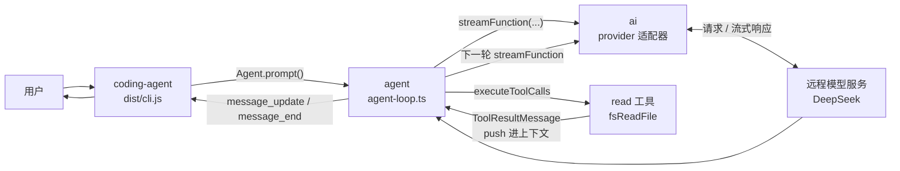

# 实践课 4：Pi Agent 的模型调用与运行流程

- 姓名：瞿凯峰　学号：202430194023　姓名拼音：QuKaifeng
- 项目：`D:\师大本科WORK\github\pi-hunnu-2026`，commit `13cbf77df2396303013a41646bcfa77b4271ae56`（实践 3 后又加了本次日志）
- 实验代号文件：`practice4.txt`，内容一行 `P4-QKF-20261126`
- 记录日期：2026-11-26

## 一、源码修改

本版本 `packages/agent/src/agent-loop.ts` 中，对应语句在原第 244 行和第 361 行附近。我按作业要求加了两行 `console.error`，实际行号变为 245 和 362。

第一处，在 `currentContext.messages.push(result)` 下方（for 循环内）：

```ts
for (const result of toolResults) {
    currentContext.messages.push(result);
    console.error("[P4] 工具结果已加入上下文"); // 新增
    newMessages.push(result);
}
```

第二处，在 `streamFunction(...)` 上方：

```ts
console.error("[P4] Agent 即将请求模型"); // 新增
const response = await streamFunction(config.model, llmContext, {
```

编辑器截图：`screenshots/S1-nano-model-call.png`（文件名、行号 362/363，能看到下方 `await streamFunction(...)`）、`screenshots/S2-nano-tool-result.png`（行号 243–247，for 循环与两行相邻代码）。完整文本差异见 `p4-code-diff.txt`。

> 说明：本机 Cursor 图形编辑器在沙箱里被系统策略拦截，无法稳定显示窗口，所以截图使用真实终端里的 GNU nano 9.2 编辑器（`nano -l` 显示行号）。画面是真实屏幕捕获，不是代码渲染图。

## 二、重新编译与启动

在仓库根目录执行 `npm run build`。截图 `screenshots/S3a-build-command.png` 显示根目录命令与编译过程，`screenshots/S3b-build-exitcode.png` 显示构建结尾 `Built packages\coding-agent\dist\bundle (56 files, 8.1 MiB)` 与 `$LASTEXITCODE` 为 `0`。完整日志见 `build-log.txt`。

启动编译产物：

```powershell
node ./packages/coding-agent/dist/cli.js
```

截图 `screenshots/S4-cli-start.png` 显示命令与 `pi v0.86.1` 交互界面。注意本版本 `dist/cli.js` 会加载 `dist/bundle` 下的启动器，两者都属于根 build 产物。

**关于日志可见性：** Pi 的交互式 TUI 会接管终端画面，`console.error` 写在交互界面里会被覆盖，退出后也不回到滚动区。为了取得真实日志，我在启动命令后加了 `2> p4-A2-stderr.txt` / `2> p4-B-stderr.txt`，把 stderr 定向到文件；会话结束后用 `Get-Content -Encoding UTF8` 在真实终端显示。截图里同时能看到输入、回复和日志原文，日志文本另存为 `A2-stderr.txt`、`B-stderr.txt`。这不是模拟输出。

## 三、两次会话的实际记录

### 会话 A：直接问答

- 输入：`请直接用一句话解释什么是 Git 分支。`
- 最终回复（截图 `screenshots/S5a-session-A-ui.png`、`S5d-session-A-logs-clean.png`）：

> Git 分支本质上就是一个指向某次提交的可移动指针，让你能从主线分出一条独立的开发线，并在其上进行不影响主线的改动。

- 是否调用工具：没有。界面没有工具调用块。
- 实际 `[P4]` 日志（按顺序，只有一条）：

```text
[P4] Agent 即将请求模型
```

- 进入模型调用的轮数：1 轮。

### 会话 B：读取文件

- 输入：`请用 read 工具读取当前目录的 practice4.txt，并告诉我文件中的实验代号。`
- 工具记录：界面显示 `read practice4.txt:1-200`（`screenshots/S6a-session-B-ui.png`）。
- 最终回复：

> 文件内容只有一行：P4-QKF-20261126，实验代号是 P4-QKF-20261126。

- 实际 `[P4]` 日志（`screenshots/S6b-session-B-logs.png`，原文 `B-stderr.txt`）：

```text
[P4] Agent 即将请求模型
[P4] 工具结果已加入上下文
[P4] Agent 即将请求模型
```

- 进入模型调用的轮数：2 轮；`read` 工具实际执行 1 次。

## 四、运行流程对比

| 项目 | A 直接问答 | B 读取文件 |
|---|---|---|
| 输入 | 一句话解释 Git 分支 | 用 read 读 practice4.txt 并说代号 |
| 工具调用 | 无 | `read practice4.txt:1-200` 一次 |
| `[P4] Agent 即将请求模型` | 1 次 | 2 次 |
| `[P4] 工具结果已加入上下文` | 0 次 | 1 次 |
| 模型调用轮数 | 1 轮 | 2 轮 |
| 最终回复 | Git 分支的一句话解释 | 返回文件中的代号 `P4-QKF-20261126` |

谁读了文件？不是模型本身，而是 agent 在 `agent-loop.ts` 中调用 `executeToolCalls` 执行了 coding-agent 注册的 `read` 工具（`packages/coding-agent/src/core/tools/read.ts`，底层 `fsReadFile`）。执行结果作为 `ToolResultMessage` 回到循环，被 `currentContext.messages.push(result)` 写入上下文；下一轮 `streamFunction(config.model, llmContext, ...)` 请求模型时，llmContext 里就比上一轮多了这条工具结果消息，所以模型能说出文件里的代号。

简图（`runtime-flow.mmd` 为可编辑图源）：



## 五、截图索引

| 编号 | 文件 |
|---|---|
| S1 | `screenshots/S1-nano-model-call.png` |
| S2 | `screenshots/S2-nano-tool-result.png` |
| S3a/S3b | `screenshots/S3a-build-command.png`、`screenshots/S3b-build-exitcode.png` |
| S4 | `screenshots/S4-cli-start.png` |
| S5 | `screenshots/S5a-session-A-ui.png`、`screenshots/S5d-session-A-logs-clean.png` |
| S6 | `screenshots/S6a-session-B-ui.png`、`screenshots/S6b-session-B-logs.png` |

Issue 标题：`实践课4：Pi Agent模型调用与运行流程 QuKaifeng`。需本人账号在课程作业仓库提交，当前未创建。
