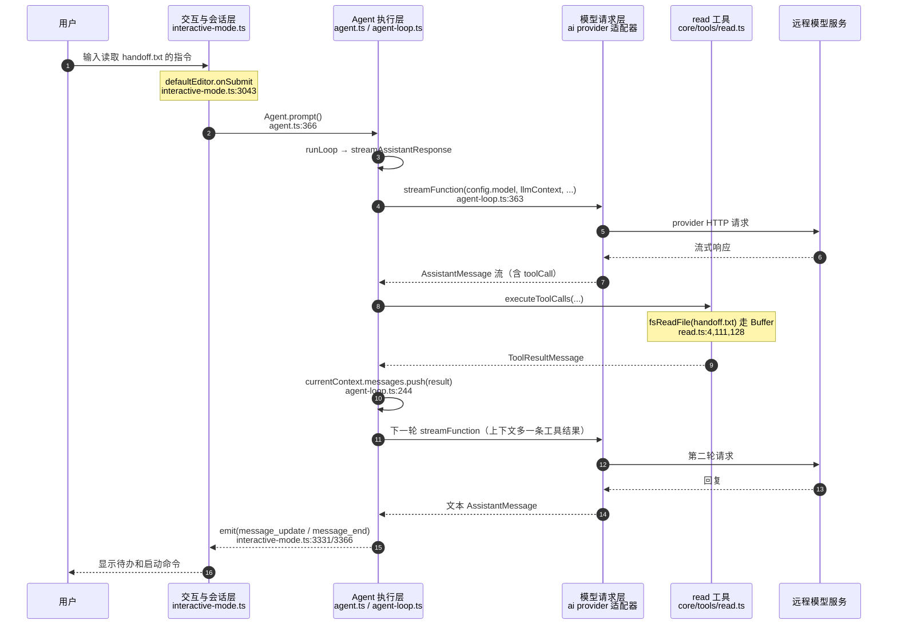
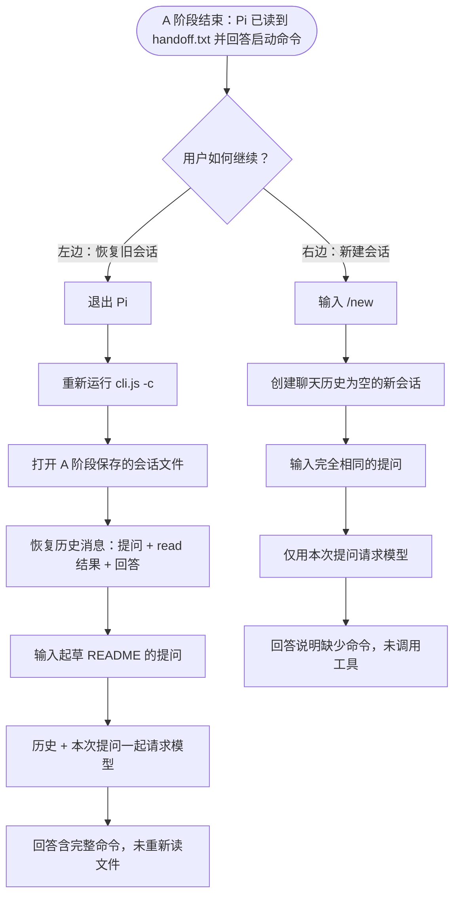

# 实践 5：Pi Agent 源码泛读与功能定位

- 姓名：瞿凯峰　学号：202430194023　姓名拼音：QuKaifeng
- 项目：`D:\师大本科WORK\github\pi-hunnu-2026`，本地启动命令 `node ./packages/coding-agent/dist/cli.js`
- 本组随机标识：`river-35089c`（现场生成后写入 `handoff.txt`）
- 记录日期：2026-11-26

## A. 单轮交互与工具调用

`handoff.txt` 实际内容：

```text
待办：补充 README 的启动说明
启动命令：npm run demo -- --profile river-35089c
```

启动本地构建的 Pi 后输入：

```text
请用 read 工具读取当前目录的 handoff.txt，原样告诉我待办和启动命令。
```

界面记录（`screenshots/A1-handoff-read.png`）：

- 工具调用：`read handoff.txt:1`
- 模型回复原文：

> 文件内容：
> - 待办：补充 README 的启动说明
> - 启动命令：npm run demo -- --profile river-35089c
> 以上为原文。

实际 `[P4]` 日志（`A-stderr.txt`，与 `A2-handoff-logs.png` 同源）：

```text
[P4] Agent 即将请求模型
[P4] 工具结果已加入上下文
[P4] Agent 即将请求模型
```

一次用户输入是一轮交互，但发生了两次模型调用：第一次模型决定调用 read，工具结果写回上下文后，第二次模型才生成自然语言回答。这与实践 04 会话 B 的等价证据一致，本节重新用 handoff.txt 跑了一遍以对应本作业。

### 图 1：单轮工具调用的代码级时序图

图源：`figure1-sequence.mmd`（可编辑）。五条生命线按职责合并；箭头和注释写真实函数/语句。文件读取按源码走 `fsReadFile` 返回 `Buffer`，是缓冲区读取，不是流式读取。



## B. 恢复上次会话，继续写 README

退出 Pi 后，在同一个项目目录运行：

```powershell
node .\packages\coding-agent\dist\cli.js -c
```

### 1. 恢复旧会话

`screenshots/B1-continue-history.png` 能看到 A 阶段的历史：用户提问、`read handoff.txt:1`、文件内容（含完整启动命令）和上次回答。随后输入：

```text
接着上次的待办，给 README 起草一条启动说明，写出交接单里的完整启动命令。只用这次会话已有的信息。不要调用工具。如果缺少命令，请直接说明。
```

`screenshots/B2-continue-answer.png` 中 Pi 的回答包含一条启动说明，命令原文为 `npm run demo -- --profile river-35089c`，并说明本次会话只提供了这一条命令。

并说明本次会话只提供了这一条命令。回复里没有工具调用块；stderr 日志只有两条 `[P4] Agent 即将请求模型` 中的第一条对应这次提问，没有 `工具结果已加入上下文`。所以它是从恢复的历史里拿到命令，而不是重新读文件。

### 2. 新建会话

输入 `/new` 后出现 `New session started`（`screenshots/B3-new-answer.png`），再输入完全相同的一句话。Pi 回答：

> 我无法起草这条说明：本次会话中没有出现过交接单，也没有任何启动命令的信息。
> 会话中唯一可用的内容是你这条消息和项目说明（AGENTS.md、目录路径等），其中不含启动命令。……

同样没有工具调用。两次结果的差别很明确：恢复会话有完整命令；新会话缺少命令，模型按提示直接说明，没有编造。

stderr 日志 `B-stderr.txt` 中两轮一共两条 `[P4] Agent 即将请求模型`，没有工具结果日志，与界面观察一致。

### 3. 对应到源码：图 2

图源：`figure2-session-branches.mmd`（可编辑）。两条分支都从 A 阶段结束开始。



## 截图与证据索引

| 文件 | 内容 |
|---|---|
| `screenshots/A1-handoff-read.png` | A 阶段输入、read 调用、待办与完整启动命令 |
| `screenshots/A2-handoff-logs.png` | A 阶段三类 [P4] 日志 |
| `screenshots/B1-continue-history.png` | `-c` 启动后可见 A 阶段聊天记录 |
| `screenshots/B2-continue-answer.png` | 恢复会话的回答，含完整命令、无工具调用 |
| `screenshots/B3-new-answer.png` | `/new` 后同问，回答缺少命令、无工具调用 |
| `A-stderr.txt`、`B-stderr.txt` | 真实 stderr 日志原文 |

Issue 标题：`实践课5：Pi Agent工具调用与会话恢复 QuKaifeng`。需本人账号在课程作业仓库提交，当前未创建。
