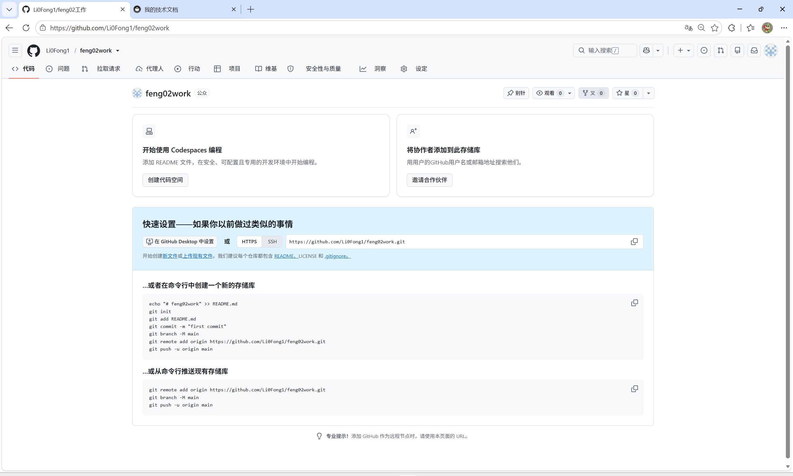
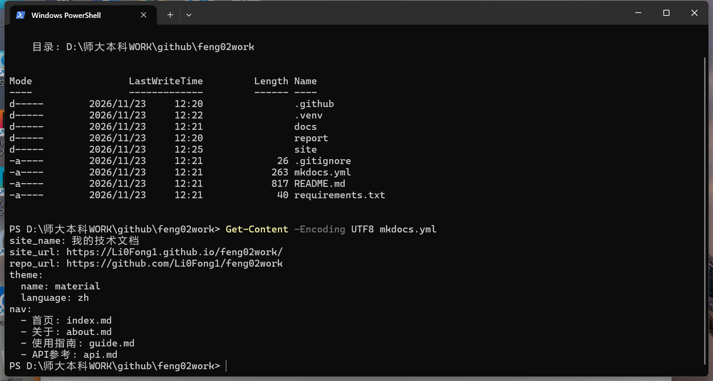
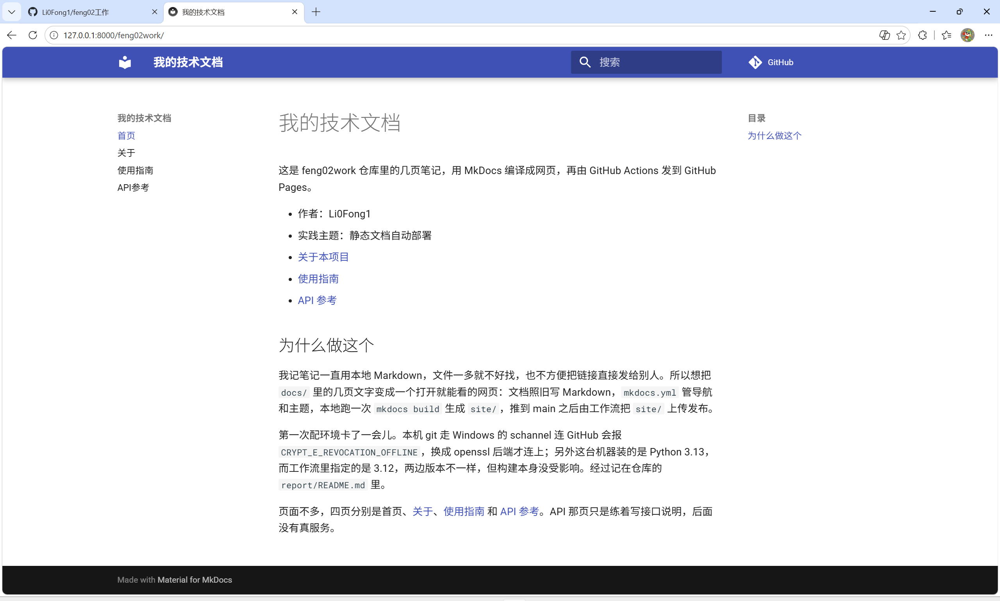
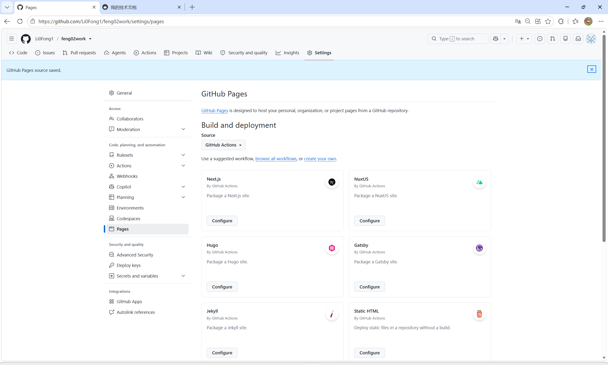
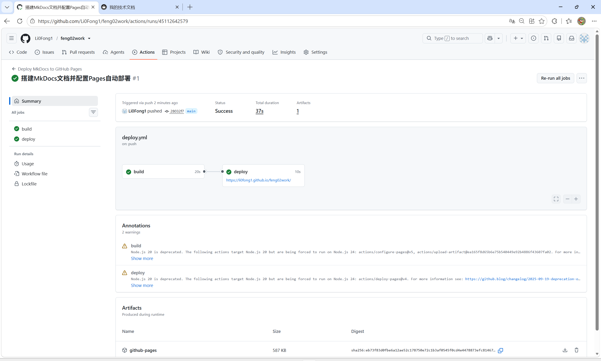
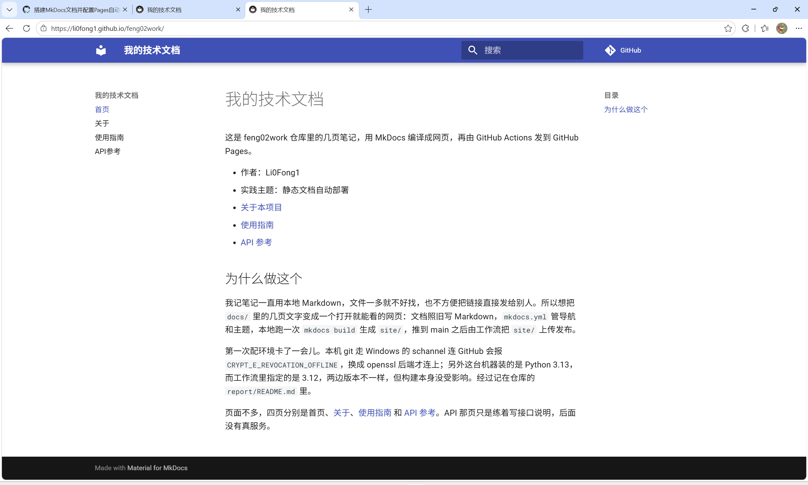
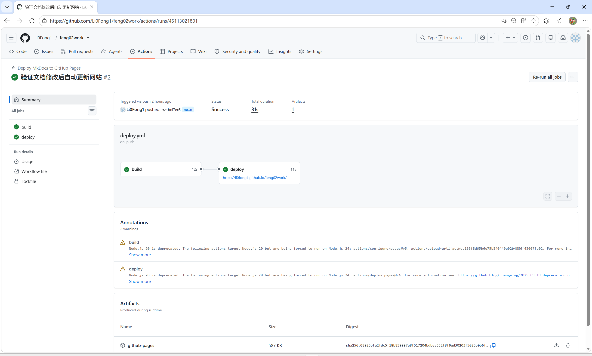
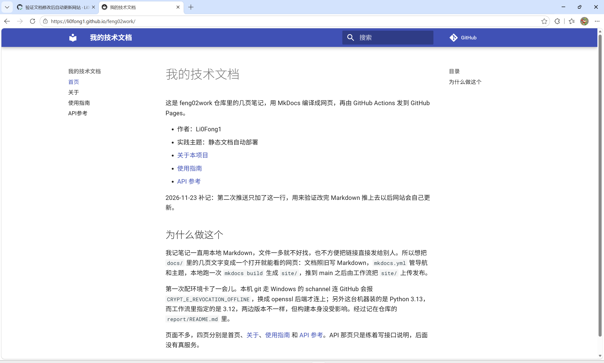

# 实践项目2：个人实验报告

## 1. 基本信息

- GitHub 登录名：Li0Fong1
- 个人仓库地址：https://github.com/Li0Fong1/feng02work
- 最终网站地址：https://li0fong1.github.io/feng02work/

仓库是 public 的，默认分支 main。文档源文件在 `docs/`，四页分别是首页、关于、使用指南、API 参考。这份报告和截图放在 `report/`。

## 2. 实践过程与关键截图

### 2.1 仓库创建

在 GitHub 上用本人账号新建了 `feng02work`，Owner 是 Li0Fong1，可见性选 Public，默认分支保持 main。建好后从 Code 页复制 HTTPS 地址，在本地用 `git clone` 拉下来。仓库刚建好是空的，克隆时 Git 提示 "You appear to have cloned an empty repository."，属于正常情况。



图里能看到所有者、仓库名和「公众」标识，右侧也列出了克隆地址 `https://github.com/Li0Fong1/feng02work.git`。

### 2.2 项目结构与 MkDocs 配置

按文档要求建了 `.github/workflows/deploy.yml`、`docs/` 四页、`report/`、`mkdocs.yml`、`requirements.txt`、`.gitignore` 和根目录 README。`docs/` 放手写的 Markdown；`site/` 是构建产物，不提交，`.gitignore` 里排除了它；`nav` 里的路径相对 `docs/` 写，不写 `docs/index.md`。



截图里上面是目录列表，下面是 `Get-Content -Encoding UTF8 mkdocs.yml` 的输出，能看到 `site_name`、`site_url`、`repo_url`、主题和四页导航配置。这台机器的 PowerShell 是 5.1，直接 `Get-Content` 读 UTF-8 文件中文会乱码，加 `-Encoding UTF8` 才正常，这是拍图时顺手发现的小问题。

### 2.3 本地构建或预览

本地建了虚拟环境：

```bash
python -m venv .venv
source .venv/Scripts/activate
python -m pip install -r requirements.txt
python -m mkdocs build --strict
python -m mkdocs serve
```

`build --strict` 实际跑通了，输出 "Documentation built in 1.72 seconds"，`site/` 下生成了 51 个文件。启动 `serve` 后浏览器打开 `http://127.0.0.1:8000/`，逐页看了导航、表格和代码块。



本机装的是 Python 3.13.14，`python -m mkdocs --version` 显示 MkDocs 1.6.1。工作流里指定的是 3.12，两边版本不一致，但构建和预览都正常。

### 2.4 Pages 设置

在个人仓库进入 Settings → Pages → Build and deployment，把 Source 从 `Deploy from a branch` 改成 `GitHub Actions`。改完页面上方出现绿色提示 "GitHub Pages source saved."。



没有建 `gh-pages` 分支，也没有改仓库默认权限、没有勾选允许 Actions 创建 PR，用的就是文档里的官方工作流。

### 2.5 Actions 首次构建和部署

提交并推送：

```bash
git add docs mkdocs.yml requirements.txt .gitignore .github/workflows/deploy.yml README.md
git commit -m "搭建MkDocs文档并配置Pages自动部署"
git push origin main
```

第一次提交是 `28032f7`（https://github.com/Li0Fong1/feng02work/commit/28032f7549216b70a15bfd0a7e57fea2f7be7849），推送后 Actions 自动运行，运行地址 https://github.com/Li0Fong1/feng02work/actions/runs/45112642579 。



`build` 用时 26 秒、`deploy` 用时 10 秒，总时长 37 秒，两个 job 都是绿勾。Artifacts 里生成了 `github-pages`，587 KB。Annotations 里有 2 条 warning，内容是 Node.js 20 即将停止支持、相关 action 会被强制用 Node 24 运行，不影响结果，但如实记下来。

### 2.6 网站访问与四页导航检查

部署完成后从运行详情页和 Pages 设置里都能看到网址，实际打开的是 `https://li0fong1.github.io/feng02work/`（GitHub 把地址栏里的用户名显示成小写）。四页都打开看过：

- 首页标题「我的技术文档」，左侧导航列出首页、关于、使用指南、API参考
- 关于页有技术组成表格
- 使用指南页有命令代码块
- API 参考页有 JSON 示例和字段表格

另外用命令逐页请求了一遍，首页、about/、guide/、api/ 都返回 200。



### 2.7 第二次推送与自动更新验证

在 `docs/index.md` 里加了一句容易认出来的话：

```
2026-11-23 补记：第二次推送只加了这一行，用来验证改完 Markdown 推上去以后网站会自己更新。
```

然后提交并推送，没有点手动部署：

```bash
git add docs/index.md
git commit -m "验证文档修改后自动更新网站"
git push origin main
```

对应提交：https://github.com/Li0Fong1/feng02work/commit/bcf7ec544351cdc308326e331465dda8da2b5132 （`bcf7ec5`）
对应运行：https://github.com/Li0Fong1/feng02work/actions/runs/45113021801



这次运行编号 #2，由 push 自动触发，状态 Success，总时长 31 秒，build 12 秒、deploy 11 秒，两个 job 都成功。



刷新网站后，新增的那句补记出现在首页正文里，说明第二次推送确实自动更新了网站。中间用过强制刷新，避免浏览器缓存造成误判。

## 3. 问题与解决

**Git 连不上 GitHub：schannel 报证书吊销检查离线。** 第一次 `git ls-remote` 报 `CRYPT_E_REVOCATION_OFFLINE (0x80092013)`，换了代理和不换代理都试过。后来在本仓库设了 `git config http.sslBackend openssl`，改用 OpenSSL 做 TLS 后端，clone 和 push 就通了。这个配置只写在本仓库，没有改全局。

**本机代理不稳定。** 环境变量里 `HTTPS_PROXY` 指向 `127.0.0.1:60409`，有时 `curl https://github.com` 返回 000 或 HTTP 000，`git ls-remote` 报连不上 `github.com:443`。用 `curl --noproxy '*'` 直连能返回 200；GitHub 的 API 域名 `api.github.com` 一直可用，我靠它核对了提交和运行记录。推送本身最后成功了，远程 main 和本地 HEAD 一致。

**PowerShell 读 UTF-8 中文乱码。** 用 `Get-Content mkdocs.yml` 时中文变成乱码，加 `-Encoding UTF8` 后正常。文件本身保存的是 UTF-8，问题出在 PowerShell 5.1 的默认编码。

**Python 版本和文档示例不一致。** 文档要求 3.12，本机只有 3.13.14，`py -3.12` 提示没有可用运行时。本地构建用 3.13 完成，工作流里仍是 3.12，CI 构建成功，所以没有额外安装 3.12。

**Action 的 Node.js 版本警告。** 两次运行各有 2 条 warning，提示 actions/configure-pages、upload-pages-artifact、deploy-pages 的目标运行时 Node 20 已弃用，会自动用 Node 24 执行。这是依赖自身的提示，构建和部署结果正常，没有改动文档给的工作流。

## 4. 原理理解

1. **`docs/` 和 `site/` 各保存什么？为什么不用手工修改 `site/`？**
   `docs/` 里是我手写的 Markdown，是源文件。`site/` 是 `mkdocs build` 编译出来的静态网页，包含 HTML、CSS、JS 和 sitemap。每次构建都会先清空再重新生成 `site/`，手工改的东西下一次构建就没了，所以不用改它，`.gitignore` 里也把它排除了，不进入仓库。

2. **本次工作流在什么情况下自动运行？**
   工作流监听 main 分支上的 push，但只盯着 `docs/**`、`mkdocs.yml`、`requirements.txt` 和 `.github/workflows/deploy.yml` 这几个路径，其中任意一个变化并推送才会触发。另外配了 `workflow_dispatch`，可以在 Actions 页面手动运行，这次验证自动更新时刻意没有手动点。

3. **build 与 deploy 两个任务有什么区别？**
   `build` 负责取源码、装 Python、装依赖、跑 `mkdocs build --strict`，再把生成的 `site/` 上传成 artifact。`deploy` 通过 `needs: build` 等它成功后才执行，把 artifact 发布到 Pages 并输出网站地址。两者权限也不同，部署任务才有 `pages: write` 和 `id-token: write`。

4. **只修改 `report/README.md` 会触发部署吗？为什么？**
   不会。工作流的 `paths` 里没有 `report/**`，所以只改报告推上去不会启动新的运行。这次提交报告就是只动了 `report/README.md` 和根目录 README，Actions 的运行次数没有增加。想让文档页面更新，得改 `docs/` 里的文件。

5. **本次方案为何无需创建 `gh-pages` 分支？**
   因为发布来源选的是 GitHub Actions，不是某个分支。工作流把 `site/` 上传成 artifact，再由官方的 `deploy-pages` action 发布，整个过程不依赖 `gh-pages` 分支，也不需要给 Actions 开创建或批准 PR 的权限。
